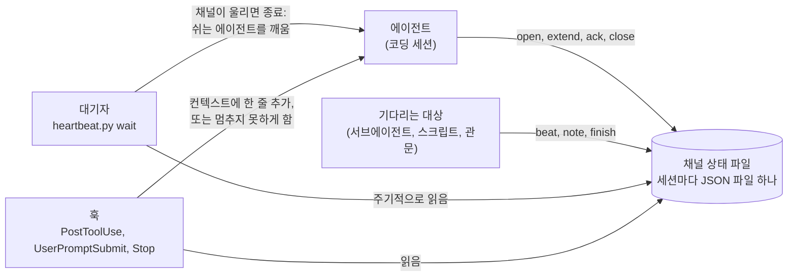

<div align="center">


# heartbeat-mcp

**백그라운드 작업을 기다리는 코딩 에이전트를 위한 데드라인과 깨우기.**

[](https://github.com/fox1245/heartbeat-mcp/actions/workflows/selftest.yml)
[](LICENSE)
[](#요구-사항)
[](#요구-사항)

[English](README.md) | 한국어

</div>

---

## 왜 필요한가

서브에이전트, 긴 빌드, 검증 관문을 시작해 놓고 기다리는 에이전트는 "작업이 끝났다"는 알림이 올 것이라는 데 기댑니다.
그 알림이 오지 않으면(프로세스가 죽었거나, 서브에이전트가 멈췄거나, 메시지가 사라졌거나) 에이전트는 그대로 멈춰 있고 다시는
확인하러 가지 않습니다. heartbeat-mcp를 쓰면 에이전트는 기다리기 시작할 때 스스로 데드라인을 정해 둡니다. 데드라인은 에이전트
바깥에서 확인되고, 생존 신호 없이 데드라인이 지나면 에이전트가 깨어나며, 작업을 살펴보기 전에는 턴을 끝낼 수 없습니다.

전체가 의존성 없는 파이썬 파일 하나입니다. 명령줄, Claude Code 하네스용 훅 진입점 세 개, stdio 위의 MCP 서버가 들어
있습니다.

## 빠른 시작

아래 단계는 1분 정도 걸립니다. `/path/to/heartbeat-mcp`는 저장소를 받은 위치로 바꾸세요.

**1. 코드를 받습니다.** 파이썬 3.8 이상과 리눅스가 필요합니다([요구 사항](#요구-사항) 참고).

```sh
git clone https://github.com/fox1245/heartbeat-mcp.git
cd heartbeat-mcp
python3 -I selftest.py        # 선택 사항. 마지막 줄이 bad=0 이어야 합니다
```

**2. 훅 세 개를 등록합니다.** `~/.claude/settings.json`에 넣습니다(파일에 이미 `hooks`가 있으면 항목을 합치세요).

```json
{
  "hooks": {
    "PostToolUse": [
      {
        "matcher": "*",
        "hooks": [{ "type": "command", "command": "python3 -I /path/to/heartbeat-mcp/heartbeat.py hook PostToolUse" }]
      }
    ],
    "UserPromptSubmit": [
      {
        "hooks": [{ "type": "command", "command": "python3 -I /path/to/heartbeat-mcp/heartbeat.py hook UserPromptSubmit" }]
      }
    ],
    "Stop": [
      {
        "hooks": [{ "type": "command", "command": "python3 -I /path/to/heartbeat-mcp/heartbeat.py hook Stop" }]
      }
    ]
  }
}
```

**3. MCP 서버를 등록합니다.** 사용자 범위로 등록하면 모든 프로젝트에서 도구를 쓸 수 있습니다.

```sh
claude mcp add --scope user heartbeat -- python3 -I /path/to/heartbeat-mcp/heartbeat.py mcp
```

**4. 직접 해 봅니다.** 명령줄은 에이전트 없이도 동작합니다. 세션 id(UUID)가 필요하고, 여기서는 일회용 상태 디렉터리를
씁니다.

```sh
export HEARTBEAT_STATE_DIR="$(mktemp -d)"
export CLAUDE_CODE_SESSION_ID="$(python3 -c 'import uuid; print(uuid.uuid4())')"

# 채널을 엽니다: "이 작업은 10초 안에 끝나야 한다"
python3 -I /path/to/heartbeat-mcp/heartbeat.py open build --label "release build" --in 10s \
    --notation "read the build log, then report"

# 대기자(waiter)를 백그라운드로 시작합니다
python3 -I /path/to/heartbeat-mcp/heartbeat.py wait &

# 잠시 뒤 대기자가 등록되어 채널을 지켜봅니다
sleep 1
python3 -I /path/to/heartbeat-mcp/heartbeat.py list
```

약 10초 뒤 대기자가 아래를 출력하고 종료합니다. Claude Code 세션에서는 이 종료가 쉬고 있는 에이전트를 깨웁니다.

```text
HEARTBEAT: 1 channel(s) fired. Look at each now, then close it, extend it or acknowledge its notes:
  [build] release build (OVERDUE: due 12:16:02, 0 min ago)
      to do: read the build log, then report
```

마무리는 `python3 -I /path/to/heartbeat-mcp/heartbeat.py close build` 입니다.

실제 세션에서는 에이전트가 4단계를 MCP 도구(`heartbeat_open` 등, [MCP 도구](#mcp-도구) 참고)로 하고, 대기자는 백그라운드
셸 명령으로 시작합니다. 대기자가 없으면 `heartbeat_open`의 응답에 정확한 명령이 들어 있습니다.

## 동작 방식



에이전트는 기다리는 것 하나마다 **채널**을 하나씩 엽니다. 채널은 세 가지 이벤트 중 하나로 울립니다(영어 원문의 "fire").

| 이벤트 | 울리는 시점 | 해소 방법 |
| --- | --- | --- |
| `OVERDUE` | 데드라인이 지났는데 채널이 아직 열려 있음 | 생존 간격이 있는 채널에서는 `beat`가 데드라인을 옮김. `extend`는 새 데드라인을 정함. `close`는 채널을 닫음 |
| `FINISHED` | 기다리는 대상이 `finish`를 호출함 | `close`. `extend`는 채널을 다시 엶 |
| `NOTE` | 기다리는 대상이 `note`를 호출했고 아직 확인(ack)되지 않음 | `ack`(데드라인은 그대로). `extend`도 확인 처리함 |

에이전트가 있을 수 있는 상태마다 알리는 방법이 다릅니다.

- 일하는 중에는 `PostToolUse`, `UserPromptSubmit` 훅이 컨텍스트에 한 줄을 추가합니다.
- 턴을 끝내려 할 때는 `Stop` 훅이, 채널이 울렸거나 열린 채널을 지켜보는 대기자가 없으면 막습니다.
- 쉬는 중에는 **대기자**(`heartbeat.py wait`, 에이전트가 백그라운드 명령으로 시작)가 채널이 울릴 때 종료합니다.
  백그라운드 명령이 끝나면 쉬는 에이전트를 다시 호출하는 하네스에서는 이 종료가 곧 깨우기입니다.

## 개념

**채널(channel).** 에이전트가 기다리는 것 하나입니다. 이름(공백 없는 출력 가능 문자 1~64자, 생략하면 16진수 여섯 자리를
생성)과 레이블이 있습니다. 열 수 있는 채널의 수에는 제한이 없고, 대기자 하나가 전부를 지켜보거나 `--channel`로 지정한
것만 지켜봅니다.

**데드라인(deadline).** `--in 40m`: 작업이 끝나 있어야 하는 시각입니다. 기간은 `90s`, `40m`, `2h`, 또는 분 단위 숫자입니다.
소수도 됩니다(`1.5h`).

**생존 간격(liveness interval).** `--every 20m`: 허용하는 가장 긴 침묵입니다. 생존 신호(`beat`, 또는 바인딩된 서브에이전트의
도구 호출)가 올 때마다 데드라인이 "지금 + 간격"으로 옮겨집니다. 채널은 데드라인, 간격, 또는 둘 다 가질 수 있습니다. 둘 다
있으면 첫 데드라인은 `--in`에서, 이후는 `--every`에서 나옵니다. `--every`만 준 채널의 첫 데드라인은 지금부터 한 간격 뒤입니다.

**주석(notation).** 채널이 울렸을 때 무엇을 할지 적은 선택적 문장입니다(예: "read /path/to/log, then merge"). 채널이
보고될 때마다 `to do:` 줄로 표시됩니다. `notate`로 나중에 설정하거나 지울 수 있습니다. `--check`는 `--notation`의 옛
표기입니다.

**바인딩된 서브에이전트(bound subagent).** `--agent ID`는 채널을 서브에이전트에 묶습니다. 서브에이전트 안에서 일어난 도구
호출의 페이로드에는 `agent_id`가 들어 있고 `PostToolUse` 훅이 이를 봅니다. 값이 채널의 agent와 같으면 그 호출이 생존
신호가 되고(채널에 생존 간격이 있으면 데드라인도 옮겨집니다), 서브에이전트 자신의 도구 호출에는 알림이 가지 않습니다.

**신호(signals).** 기다리는 대상은 자기 채널에 말할 수 있습니다. `beat`(아직 살아 있음, 진행 문구는 선택), `note`(주의가
필요함), `finish`(끝남, 결과 문구는 선택)입니다. 스크립트에서 쓰려면 세션의 `CLAUDE_CODE_SESSION_ID`(세션이 시작한 명령은
이를 물려받습니다) 또는 `--session`이 필요합니다.

## 명령줄 참조

`python3 -I heartbeat.py [--session ID] COMMAND ...`. 기간은 `90s`, `40m`, `2h`, 또는 분입니다. 호출자 오류는 stderr에
`heartbeat: ...`를 출력하고 종료 코드 2로 끝납니다. `--session`은 명령 앞에 둡니다.

| 명령 | 하는 일 | 인자 |
| --- | --- | --- |
| `open` | 기다리는 것 하나를 위한 채널을 엶 | `[NAME]` 공백 없는 짧은 이름(생략하면 생성). `--label LABEL`(필수) 무엇이 실행 중인지. `--in DURATION` 끝날 때까지 예상 시간. `--every EVERY` 생존 신호 사이에 허용하는 가장 긴 침묵. `--notation TEXT`(별칭 `--check`) 채널이 울릴 때 할 일. `--agent ID` 도구 호출이 생존 신호로 쓰이는 서브에이전트. `--in`과 `--every` 중 하나는 필수 |
| `beat` | 기다리는 대상이 보내는 생존 신호 | `NAME`. `--text TEXT` 진행 문구 |
| `finish` | 기다리는 대상이 끝났음 | `NAME`. `--text TEXT` 결과 문구 |
| `note` | 기다리는 대상이 주의를 요청함 | `NAME`. `--text TEXT`(필수) 메시지 |
| `extend` | 살펴보니 작업이 계속되는 중: 지금부터 센 새 데드라인. 메모는 확인 처리되고 끝난 채널은 다시 열림 | `NAME`. `--in DURATION`(필수) |
| `ack` | 채널의 메모를 확인함. 데드라인은 그대로 | `NAME` |
| `notate` | 채널이 울릴 때 할 일을 설정하거나 지움 | `NAME`. `--text TEXT`(생략하면 지움) |
| `close`(별칭 `done`) | 살펴본 뒤 채널을 닫음 | `NAME` |
| `list` | 열린 채널과 대기자가 지켜보는지 여부 | 없음 |
| `wait` | 채널이 울릴 때까지 블록(백그라운드로 실행) | `--channel NAME` 이 채널만 지켜봄(반복 가능) |
| `hook` | 훅 진입점: stdin에 JSON, stdout에 JSON | `EVENT`: `PostToolUse`, `UserPromptSubmit`, `Stop` |
| `mcp` | stdio MCP 서버 | 없음 |

`wait`는 울린 채널을 전부 출력하고 종료 코드 0으로 끝납니다. 아직 조용한 채널은 개수와 앞의 다섯 개 이름만 보여 주고,
그런 채널이 있으면 대기자를 다시 시작하라고 알려 줍니다. 열린 채널이 아무리 많아도 출력은 작게 유지됩니다. 기다릴
것이 없으면 그 사실을 출력하고(`heartbeat: no open channel to wait for`) 바로 끝납니다.

`open`, `extend`, `ack`, `close`는 열린 채널이 대기자 없이 남으면 출력 끝에 대기자를 시작하는 명령을 덧붙입니다.

## MCP 도구

`python3 -I heartbeat.py mcp`는 stdio 위에서 한 줄에 JSON 객체 하나씩 JSON-RPC 2.0으로 통신합니다(`initialize`, `ping`,
`tools/list`, `tools/call`). 실패한 호출은 프로토콜 오류가 아니라 `isError: true`인 도구 결과입니다. 도구는 위의
명령에 대응하며, 여기서 시간 단위는 분입니다.

| 도구 | 인자(굵은 글씨는 필수) | 하는 일 |
| --- | --- | --- |
| `heartbeat_open` | **`label`**, `name`, `minutes`, `every_minutes`, `notation`, `agent` | 채널을 엶. `minutes`와 `every_minutes` 중 하나는 필수. 열린 채널이 대기자 없이 남으면 응답에 대기자 명령이 들어 있음(`heartbeat_extend`, `heartbeat_ack`, `heartbeat_close`의 응답도 같음) |
| `heartbeat_beat` | **`name`**, `text` | 생존 신호 |
| `heartbeat_note` | **`name`**, **`text`** | 주의를 요청함. 확인될 때까지 채널이 울림 |
| `heartbeat_finish` | **`name`**, `text` | 작업이 끝났다고 보고함. 닫힐 때까지 채널이 울림 |
| `heartbeat_extend` | **`name`**, **`minutes`** | 새 데드라인(지금 + `minutes`). 메모는 확인 처리됨 |
| `heartbeat_ack` | **`name`** | 메모를 확인함. 데드라인은 그대로 |
| `heartbeat_notate` | **`name`**, `notation` | 주석을 설정하거나 `null`로 지움 |
| `heartbeat_close` | **`name`** | 채널을 닫음 |
| `heartbeat_list` | 없음 | 열린 채널과, 대기자가 지켜보지 않는 채널을 나열함 |

서버가 세션을 정하는 방법은 [상태 파일과 잠금](#상태-파일과-잠금)에 있습니다.

## 훅

세 훅 모두 하네스의 JSON을 stdin으로 읽고 stdout으로 JSON을 답합니다. 호스트를 실패시키지 않으며, 어떤 오류든 `{}`로
답합니다. 채널을 연 적 없는 세션은 `stat` 호출 한 번의 비용으로 `{}`를 받습니다.

| 훅 | 동작 |
| --- | --- |
| `PostToolUse`, `UserPromptSubmit` | 호출이 서브에이전트 안에서 일어났다면(페이로드에 `agent_id`가 있음) 그 agent에 묶인 열린 채널의 생존 신호로 세고 `{}`를 답합니다. 그렇지 않으면, 울린 채널이 있고 최근 `HEARTBEAT_NAG_SEC` 동안 언급되지 않았다면 울린 채널 전부를 에이전트의 컨텍스트(`additionalContext`)에 추가합니다. 울린 것은 없는데 열린 채널에 대기자가 없으면, 대기자 명령을 알리는 문구를 `HEARTBEAT_ARM_NAG_SEC`에 한 번 이하로 추가합니다. |
| `Stop` | 채널이 울렸거나 열린 채널을 지켜보는 대기자가 없는 동안 턴 종료를 막습니다(`decision: block`, 사유는 에이전트에게 보임). 울린 채널 때문에 막을 때는 지켜보는 대기자가 없는 열린 채널도 함께 알리고, 울린 채널을 처리한 뒤 대기자를 시작하라고 안내합니다. 페이로드에 `stop_hook_active`가 있으면(Stop 훅 때문에 턴이 이어진 경우) 울린 채널 때문에는 막지 않지만, 지켜보는 대기자가 없는 채널 때문에는 연속으로 최대 `HEARTBEAT_STOP_UNWATCHED_MAX`번까지 계속 막습니다. 그 뒤에는 턴이 끝나도록 두고 `systemMessage`로 그 사실을 알립니다. 대기자를 시작하거나 막지 않은 Stop이 있으면 이 횟수는 0으로 돌아갑니다. |

동작을 조절하는 환경 변수입니다(숫자가 아닌 값은 기본값으로 돌아갑니다).

| 변수 | 기본값 | 의미 |
| --- | --- | --- |
| `HEARTBEAT_STATE_DIR` | `~/.local/state/heartbeat-mcp` | 세션별 상태 파일 위치 |
| `HEARTBEAT_NAG_SEC` | `300` | 울린 채널을 에이전트 컨텍스트에서 반복하는 간격 |
| `HEARTBEAT_ARM_NAG_SEC` | `600` | "채널을 지켜보는 대기자가 없음" 안내를 반복하는 간격 |
| `HEARTBEAT_STOP_UNWATCHED_MAX` | `3` | 열린 채널에 대기자가 없다는 이유로 `Stop`이 연속으로 막는 최대 횟수. 그 뒤에는 턴이 끝나도록 둠(0 이상의 정수가 아니면 기본값) |
| `HEARTBEAT_WAIT_POLL_SEC` | `15` | 대기자가 상태를 다시 읽는 최대 간격(다음 데드라인에도 깨며, 1초보다 짧게는 쉬지 않음) |
| `CLAUDE_CODE_SESSION_ID` | 하네스가 설정 | 명령이 속한 세션 |

## 상태 파일과 잠금

- 세션마다 JSON 파일 하나: `$HEARTBEAT_STATE_DIR/<세션-uuid>.json`. 디렉터리 권한은 `0700`, 파일 권한은 `0600`입니다.
  채널(이름, 레이블, 주석, 데드라인, 간격, 묶인 agent, 상태, beat 횟수, 메모, finish 문구), 실행 중인 대기자(프로세스
  id, 프로세스 시작 시각, 각자 지켜보는 채널), 마지막 안내 시각, 지켜보는 대기자가 없다는 이유로 `Stop`이 연속으로 막은
  횟수가 들어 있습니다.
- `list`와 대기자의 매 폴링을 포함한 모든 연산이 읽고 쓰는 동안 상태 파일에 배타적 `flock`을 잡습니다. 그래서 명령줄,
  훅, MCP 서버, 여러 대기자가 동시에 돌아도 됩니다.
- 대기자는 자신의 프로세스 id와 프로세스 시작 시각(`/proc/<pid>/stat`의 22번째 필드)을 기록합니다. 기록된 대기자는
  그 id의 프로세스가 같은 시작 시각을 갖고, 멈춰 있지 않고, 이 `heartbeat.py`(상대 경로와 심볼릭 링크는 해석함)를 `wait`
  하위 명령으로 실행한 것일 때만 유효합니다(`wait`가 다른 인자로 들어 있으면 안 됨). 그래서 재사용된 프로세스 id는
  인정되지 않습니다. 다음 폴링에서 종료할 대기자, 즉 지켜보는 채널이 울렸거나 지켜볼 열린 채널이 없는 대기자는 다른
  채널을 지켜보는 것으로 치지 않습니다. 대기자는 종료하기로 정한 같은 잠금 구간에서, 출력하기 전에 자기 기록을
  지웁니다. 사라졌거나 기록된 프로세스가 아닌 항목은 다음에 상태를 쓸 때 지워지고, 멈춰 있는 대기자는 다시 이어질 수
  있으므로 남습니다.
- 닫힌 채널은 24시간 동안 파일에 남고, 그 뒤 다음에 채널을 닫을 때 지워집니다. 닫힌 채널의 이름은 다시 쓸 수 있습니다.
- 세션은 다음 순서로 정해집니다. `--session` 옵션 또는 훅 페이로드의 `session_id`, `CLAUDE_CODE_SESSION_ID`, 그리고
  이런 파일을 가진 가장 가까운 조상 프로세스의 `~/.claude/sessions/<pid>.json`에 있는 `sessionId`(최대 16단계, `/proc`로
  찾음). UUID여야 하며, 덕분에 파일 이름으로도 안전합니다.

## 요구 사항

- 파이썬 3.8 이상. 자체 테스트는 3.8, 3.9, 3.10, 3.11, 3.12, 3.13, 3.14에서 통과합니다. 표준 라이브러리 밖의 것은
  쓰지 않습니다.
- 리눅스. `fcntl` 잠금을 쓰고, 대기자와 조상 프로세스를 찾으려고 `/proc`을 읽습니다. 다른 환경에서는 시험하지
  않았습니다. `/proc`이 없으면 대기자가 실행 중인 것으로 인정되지 않아 `Stop` 훅이 계속 대기자를 요구합니다. 윈도우에는
  `fcntl`이 없습니다.
- 훅과 깨우기에는 Claude Code, 또는 같은 훅 페이로드와 백그라운드 명령을 갖춘 하네스가 필요합니다. 명령줄과 MCP
  서버는 이에 의존하지 않습니다.

## 한계와 비목표

- 실패한 훅은 `{}`로 답합니다. 호스트의 훅이 이 도구 때문에 깨지는 일은 없지만, 그래서 망가진 heartbeat는 조용합니다.
- 대기자는 에이전트가 시작해야 합니다(`Stop` 훅이 이를 요구합니다).
- 채널은 한 세션에 속합니다.
- 다른 기계에서 보내는 beat나 finish 신호에는 이 기계로 돌아오는 길이 필요합니다(원격 명령이 끝난 뒤 신호 명령을 이쪽에서
  실행하세요).
- 데드라인은 시스템의 벽시계를 씁니다. 시각은 날짜 없이 지역 시간 `HH:MM:SS`로 출력됩니다.
- 대기자는 폴링하므로 신호를 최대 `HEARTBEAT_WAIT_POLL_SEC`만큼 늦게 알아챌 수 있습니다. 데드라인은 데드라인 시각에
  알아챕니다.
- 상태 파일은 제자리에서 다시 쓰입니다. 쓰는 도중 프로세스가 죽으면 읽을 수 없는 파일이 남을 수 있으며, 그 세션의 파일을
  지우면 초기화됩니다.
- 인증이 없습니다. 세션 id를 아는 같은 사용자의 어떤 프로세스든 채널에 신호를 보낼 수 있습니다.
- 목표가 아닌 것: 작업 자체를 시작하거나 감독하기, 재시도, 사람에게 알리기, 이력 저장.

## FAQ

**에이전트 안에서 오래 sleep하거나 폴링 루프를 돌리지 않고 왜 대기자를 쓰나요?** 에이전트 자신의 턴 안에서 sleep이나 루프를
돌리면 에이전트가 계속 바쁘고, 그 턴이 살아남아야 한다는 가정에 기대게 됩니다. 대기자는 평범한 백그라운드 명령입니다.
에이전트는 쉴 수 있고, 대기자가 종료하면 호스트가 에이전트를 다시 호출합니다. 훅은 에이전트가 바쁘거나 멈추려 할 때를
맡습니다.

**Claude Code가 꼭 필요한가요?** 명령줄과 MCP 서버는 평범한 프로그램입니다. 훅은 Claude Code의 훅 형식(`session_id`,
`agent_id`, `stop_hook_active`, `decision`/`reason`, `systemMessage`, `hookSpecificOutput.additionalContext`)을 쓰고, 깨우기에는 백그라운드
명령이 끝나면 쉬는 에이전트를 다시 호출하는 호스트가 필요합니다.

**대기자를 시작하는 것을 잊거나 대기자가 죽으면요?** `Stop` 훅이 턴 종료를 막고 아무도 지켜보지 않는 채널을 알려 주며,
`PostToolUse`, `UserPromptSubmit` 훅도 가끔 상기시킵니다. `list`는 `NOT covered by a waiter: ...`를 보여 줍니다.

**`Stop` 훅이 에이전트를 계속 되돌려 보냅니다. 어떻게 빠져나오나요?** 울린 채널을 하나씩 살펴본 뒤 `close`하거나
`extend`하거나 메모를 `ack`하세요. 대기자가 없는 채널에는 대기자를 시작하세요. 울린 채널은 턴을 끝내려 할 때마다 한 번 막고, 대기자가 없는
채널은 연속으로 최대 `HEARTBEAT_STOP_UNWATCHED_MAX`번만 막으므로 무한 반복은 없습니다.

**세션 둘, 혹은 기계 둘이 채널을 공유할 수 있나요?** 아니요. 상태는 세션별, 기계별입니다. 다른 기계의 스크립트는 상태를
가진 기계를 거쳐 신호를 보내야 합니다.

## 기여

이슈와 풀 리퀘스트를 환영합니다. 프로젝트는 일부러 파일 하나로 유지합니다. 표준 라이브러리만 쓰세요.

```sh
python3 -I selftest.py
```

자체 테스트는 실제 프로그램을 서브프로세스로 실행하며 임시 상태 디렉터리를 씁니다. 검사마다 한 줄을 출력하고 `bad=<n>`으로
끝나며, `bad=0`이어야 합니다(실제 데드라인을 기다리므로 30초쯤 걸립니다). 동작을 바꾸면 그에 대한 검사를 추가하세요.

## 라이선스

[MIT](LICENSE), 저작권 2026 fox1245.
