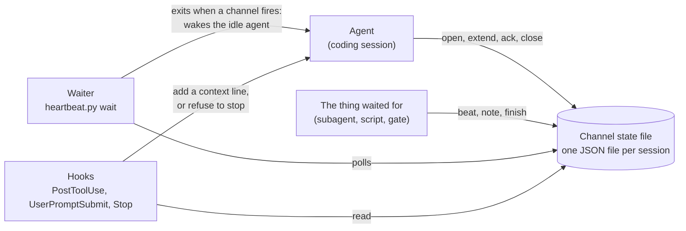

<div align="center">


# heartbeat-mcp

**Deadlines and wake-ups for a coding agent that waits on background work.**

[](https://github.com/fox1245/heartbeat-mcp/actions/workflows/selftest.yml)
[](LICENSE)
[](#requirements)
[](#requirements)

English | [한국어](README.ko.md)

</div>

---

## Why

An agent that starts a subagent, a long build or a verification gate and then waits for it depends on a notice that
the work is done. If that notice never comes (the process died, the subagent stalled, the message was lost), the agent
sits idle and never looks. With heartbeat-mcp the agent sets itself a deadline when it starts waiting. The deadline is
checked outside the agent, and when it passes without a sign of life the agent is woken up and cannot end its turn
before it has looked at the work.

Everything is one Python file with no dependencies: a command line, three hook entry points for the Claude Code
harness, and an MCP server over stdio.

## Quick start

The steps below take about a minute. Replace `/path/to/heartbeat-mcp` with the place you cloned the repository to.

**1. Get the code.** Python 3.8 or newer and a Linux system are required (see [Requirements](#requirements)).

```sh
git clone https://github.com/fox1245/heartbeat-mcp.git
cd heartbeat-mcp
python3 -I selftest.py        # optional; the last line must be: bad=0
```

**2. Register the three hooks** in `~/.claude/settings.json` (merge the `hooks` entries if the file already has some):

```json
{
  "hooks": {
    "PostToolUse": [
      {
        "matcher": "*",
        "hooks": [{ "type": "command", "command": "python3 -I /path/to/heartbeat-mcp/heartbeat.py hook PostToolUse" }]
      }
    ],
    "UserPromptSubmit": [
      {
        "hooks": [{ "type": "command", "command": "python3 -I /path/to/heartbeat-mcp/heartbeat.py hook UserPromptSubmit" }]
      }
    ],
    "Stop": [
      {
        "hooks": [{ "type": "command", "command": "python3 -I /path/to/heartbeat-mcp/heartbeat.py hook Stop" }]
      }
    ]
  }
}
```

**3. Register the MCP server** (user scope, so every project has the tools):

```sh
claude mcp add --scope user heartbeat -- python3 -I /path/to/heartbeat-mcp/heartbeat.py mcp
```

**4. Try it by hand.** The command line works without an agent. It needs a session id (a UUID) and, here, a throwaway
state directory:

```sh
export HEARTBEAT_STATE_DIR="$(mktemp -d)"
export CLAUDE_CODE_SESSION_ID="$(python3 -c 'import uuid; print(uuid.uuid4())')"

# open a channel: "this should be finished in 10 seconds"
python3 -I /path/to/heartbeat-mcp/heartbeat.py open build --label "release build" --in 10s \
    --notation "read the build log, then report"

# start the waiter in the background
python3 -I /path/to/heartbeat-mcp/heartbeat.py wait &

# a moment later the waiter is registered and covers the channel
sleep 1
python3 -I /path/to/heartbeat-mcp/heartbeat.py list
```

About ten seconds later the waiter prints the following and exits. In a Claude Code session that exit is what wakes
an idle agent:

```text
HEARTBEAT: 1 channel(s) fired. Look at each now, then close it, extend it or acknowledge its notes:
  [build] release build (OVERDUE: due 12:16:02, 0 min ago)
      to do: read the build log, then report
```

Finish with `python3 -I /path/to/heartbeat-mcp/heartbeat.py close build`.

In a real session the agent does step 4 with the MCP tools (`heartbeat_open` and the others, see
[MCP tools](#mcp-tools)) and starts the waiter as a background shell command. `heartbeat_open` replies with the exact
command when no waiter is running.

## How it works



The agent opens one **channel** for each thing it waits for. A channel fires on one of three events:

| Event | When it fires | How it is cleared |
| --- | --- | --- |
| `OVERDUE` | the deadline has passed and the channel is still open | `beat` on a channel with a liveness interval moves the deadline; `extend` sets a new one; `close` ends the channel |
| `FINISHED` | the thing waited for called `finish` | `close`; `extend` reopens the channel |
| `NOTE` | the thing waited for called `note` and the note is not acknowledged yet | `ack` (the deadline stays); `extend` also acknowledges |

The agent is told in three ways, which cover the different states it can be in:

- while it is working, the `PostToolUse` and `UserPromptSubmit` hooks add a line to its context;
- when it tries to end its turn, the `Stop` hook refuses while a channel has fired or while an open channel has no
  waiter;
- while it is idle, a **waiter** (`heartbeat.py wait`, started by the agent as a background command) exits when a
  channel fires. A harness that re-invokes an idle agent when a background command exits turns this into a wake-up.

## Concepts

**Channel.** One thing the agent waits for. It has a name (1 to 64 printable characters, no spaces; six hex digits are
generated when omitted) and a label. The number of open channels is not limited, and one waiter watches all of them,
or only those named with `--channel`.

**Deadline.** `--in 40m`: when the work should be finished. Durations are `90s`, `40m`, `2h`, or a bare number of
minutes. Fractions work (`1.5h`).

**Liveness interval.** `--every 20m`: the longest silence allowed. Every sign of life (a `beat`, or a tool call of a
bound subagent) moves the deadline to now plus the interval. A channel may have a deadline, an interval or both; with
both, the first deadline comes from `--in` and later ones from `--every`. A channel opened with only `--every` has its
first deadline one interval from now.

**Notation.** Optional text saying what to do when the channel fires (for example, "read /path/to/log, then merge").
It is shown every time the channel is reported, as a `to do:` line. `notate` sets or clears it later. `--check` is an
older spelling of `--notation`.

**Bound subagent.** `--agent ID` binds a channel to a subagent. The `PostToolUse` hook sees an `agent_id` in the
payload of a tool call made inside a subagent. If it equals the channel's agent, the call counts as a sign of life
(and moves the deadline when the channel has a liveness interval). A subagent's own tool calls get no reminders.

**Signals.** The thing waited for can speak on its channel: `beat` (still alive, with an optional progress text),
`note` (needs attention) and `finish` (done, with an optional result text). From a script they need the session's
`CLAUDE_CODE_SESSION_ID`, which commands started by the session inherit, or `--session`.

## Command line reference

`python3 -I heartbeat.py [--session ID] COMMAND ...`. Durations are `90s`, `40m`, `2h`, or minutes. Caller errors print
`heartbeat: ...` on stderr and exit with status 2. `--session` goes before the command.

| Command | What it does | Arguments |
| --- | --- | --- |
| `open` | open a channel for one thing you wait for | `[NAME]` a short name without spaces (generated when omitted); `--label LABEL` (required) what is running; `--in DURATION` expected time until it is finished; `--every EVERY` longest silence allowed between signs of life; `--notation TEXT` (alias `--check`) what to do when the channel fires; `--agent ID` a subagent whose tool calls count as signs of life. One of `--in` and `--every` is required |
| `beat` | a sign of life, from the thing waited for | `NAME`; `--text TEXT` progress message |
| `finish` | the thing waited for is done | `NAME`; `--text TEXT` result message |
| `note` | the thing waited for asks for attention | `NAME`; `--text TEXT` (required) the message |
| `extend` | you looked and the work goes on: a new deadline, counted from now; notes are acknowledged and a finished channel is reopened | `NAME`; `--in DURATION` (required) |
| `ack` | acknowledge a channel's notes; the deadline stays | `NAME` |
| `notate` | set or clear what to do when the channel fires | `NAME`; `--text TEXT` (omit to clear) |
| `close` (alias `done`) | close a channel after you looked | `NAME` |
| `list` | open channels and whether waiters cover them | none |
| `wait` | block until a channel fires (run it in the background) | `--channel NAME` watch only this channel (repeatable) |
| `hook` | hook entry: JSON on stdin, JSON on stdout | `EVENT`: `PostToolUse`, `UserPromptSubmit` or `Stop` |
| `mcp` | MCP server on stdio | none |

`wait` prints the channels that fired, in full, and exits with status 0. For the channels that are still quiet it gives
their number and the names of the first five, and, when there are any, reminds the agent to start a waiter again; the
text stays small however many channels are open. With nothing to wait for it says so (`heartbeat: no open channel to
wait for`) and exits at once.

`open`, `extend`, `ack` and `close` end their output with the command that starts a waiter when open channels are left
without one.

## MCP tools

`python3 -I heartbeat.py mcp` speaks JSON-RPC 2.0 over stdio, one JSON object per line (`initialize`, `ping`,
`tools/list`, `tools/call`). A failing call is a tool result with `isError: true`, not a protocol error. The tools are
the commands above; times are in minutes here.

| Tool | Arguments (required in bold) | Does |
| --- | --- | --- |
| `heartbeat_open` | **`label`**, `name`, `minutes`, `every_minutes`, `notation`, `agent` | open a channel; one of `minutes` and `every_minutes` is required; the reply carries the waiter command when open channels are left without a waiter (so do the replies of `heartbeat_extend`, `heartbeat_ack` and `heartbeat_close`) |
| `heartbeat_beat` | **`name`**, `text` | a sign of life |
| `heartbeat_note` | **`name`**, **`text`** | ask for attention; the channel fires until acknowledged |
| `heartbeat_finish` | **`name`**, `text` | report that the work is done; the channel fires until closed |
| `heartbeat_extend` | **`name`**, **`minutes`** | new deadline (now plus `minutes`); notes are acknowledged |
| `heartbeat_ack` | **`name`** | acknowledge the notes; the deadline stays |
| `heartbeat_notate` | **`name`**, `notation` | set the notation, or clear it with `null` |
| `heartbeat_close` | **`name`** | close the channel |
| `heartbeat_list` | none | list open channels and which are not watched by a waiter |

The server resolves the session as described under [State files and locking](#state-files-and-locking).

## Hooks

All three hooks read the harness's JSON from stdin and answer with JSON on stdout. They never fail the host: any error
answers `{}`. A session that never opened a channel costs one `stat` call and gets `{}`.

| Hook | Behaviour |
| --- | --- |
| `PostToolUse`, `UserPromptSubmit` | If the call was made inside a subagent (the payload has `agent_id`): counts as a sign of life on the open channels bound to that agent, answers `{}`. Otherwise: if a channel has fired and was not mentioned during the last `HEARTBEAT_NAG_SEC`, adds all fired channels to the agent's context (`additionalContext`). If nothing fired but open channels have no waiter, adds a reminder naming the waiter command, at most once per `HEARTBEAT_ARM_NAG_SEC`. |
| `Stop` | Refuses to end the turn (`decision: block`, with the reason shown to the agent) while a channel has fired, and also while an open channel is not watched by a waiter. The refusal for a fired channel names the unwatched open channels as well and says to start a waiter once the fired channels are handled. A payload with `stop_hook_active` (the turn continued because of a Stop hook) is not refused for a fired channel, but it is still refused for unwatched channels, at most `HEARTBEAT_STOP_UNWATCHED_MAX` times in a row: then the hook lets the turn end and says so in a `systemMessage`. Starting a waiter, or a Stop that does not block, resets that count. |

When the state stays locked by another process for longer than `HEARTBEAT_LOCK_WAIT_SEC`, a hook cannot read it and
answers without breaking the host: `{}` for `PostToolUse` and `UserPromptSubmit`, and for `Stop` an answer that does
not refuse, only a `systemMessage` saying that the state is locked and open channels may be unwatched. `Stop` lets the
turn end here because it can neither see the channels nor count its refusals, and a refusal it cannot bound could
repeat for ever.

Environment variables that tune the behaviour (a value that is not a number falls back to the default):

| Variable | Default | Meaning |
| --- | --- | --- |
| `HEARTBEAT_STATE_DIR` | `~/.local/state/heartbeat-mcp` | where the per-session state files live |
| `HEARTBEAT_NAG_SEC` | `300` | a fired channel is repeated in the agent's context this often |
| `HEARTBEAT_ARM_NAG_SEC` | `600` | the "channels are not covered by a waiter" reminder is repeated this often |
| `HEARTBEAT_STOP_UNWATCHED_MAX` | `3` | how many times in a row `Stop` refuses because open channels have no waiter before it lets the turn end (a value that is not a whole number of zero or more falls back to the default) |
| `HEARTBEAT_LOCK_WAIT_SEC` | `2` | how long taking the state file's lock may take before the command gives up (see [State files and locking](#state-files-and-locking)) |
| `HEARTBEAT_WAIT_POLL_SEC` | `15` | a waiter re-reads the state at least this often (it also wakes at the next deadline, and never sleeps less than one second) |
| `CLAUDE_CODE_SESSION_ID` | set by the harness | the session the command belongs to |

## State files and locking

- One JSON file per session: `$HEARTBEAT_STATE_DIR/<session-uuid>.json`, in a directory with mode `0700`, file mode
  `0600`. It holds the channels (name, label, notation, deadline, interval, bound agent, status, beat count, notes,
  finish text), the running waiters (process id, process start time and the channels each watches), the time of the last reminder and
  the number of `Stop` refusals in a row for unwatched channels.
- Every operation, including `list` and each poll of a waiter, takes an exclusive `flock` on the state file for its
  whole read-modify-write, so the command line, the hooks, the MCP server and any number of waiters can run at once.
- A waiter records its process id and its process start time (field 22 of `/proc/<pid>/stat`). A recorded waiter counts
  only while the process with that id has that start time, is not stopped, and was started as this `heartbeat.py`
  (relative paths and symbolic links are resolved) with `wait` as the subcommand, not as any other argument. A reused
  process id therefore does not count. A waiter that will exit on its next poll, because a channel it watches has
  fired or it watches no open channel, does not count as watching the other channels. A waiter removes its own record
  in the locked section in which it decides to exit, before it prints. Records of processes that are gone or are not
  the recorded process are dropped when the state is next written; a stopped waiter stays, because it may be
  continued.
- Taking the lock does not wait for ever. A process that holds it (stopped or hung) would otherwise stall every
  command and hook of the session. After `HEARTBEAT_LOCK_WAIT_SEC` the command exits with status 2 and
  `heartbeat: the state of this session is locked by another process ...`, an MCP tool returns that text as a tool
  error, a hook answers as described under [Hooks](#hooks), and a waiter tries again at its next poll.
- Closed channels stay in the file for 24 hours, then they are dropped the next time a channel is closed. A closed
  channel's name can be opened again.
- The session is, in order: the `--session` option or the hook payload's `session_id`; `CLAUDE_CODE_SESSION_ID`; the
  `sessionId` in `~/.claude/sessions/<pid>.json` of the nearest ancestor process that has such a file (up to 16
  levels, found through `/proc`). It must be a UUID, which also keeps it safe as a file name.

## Requirements

- Python 3.8 or newer. The self-test passes on 3.8, 3.9, 3.10, 3.11, 3.12, 3.13 and 3.14. Nothing from outside the
  standard library is used.
- Linux. The program uses `fcntl` locks and reads `/proc` to find waiters and ancestor processes. It has not been
  tried elsewhere; without `/proc` a waiter is never recognised as running, so the `Stop` hook would keep asking for
  one. Windows has no `fcntl`.
- For the hooks and the wake-up: Claude Code, or a harness with the same hook payloads and background commands.
  The command line and the MCP server do not depend on it.

## Limits and non-goals

- A hook that fails answers `{}`: the host's hooks never break because of it, so a broken heartbeat is silent.
- A waiter must be started by the agent (the `Stop` hook insists on it).
- Channels belong to one session.
- A beat or finish signal from another machine needs a way back to this one (run the signalling command locally after
  the remote command returns).
- Deadlines use the system's wall clock; times are printed as local `HH:MM:SS` without a date.
- A waiter polls, so it can notice a signal up to `HEARTBEAT_WAIT_POLL_SEC` late. A deadline is noticed at the
  deadline.
- The state file is rewritten in place. A process killed during the write can leave an unreadable file; delete that
  session's file to reset it.
- There is no authentication: any process of the same user that knows the session id can signal a channel.
- Not goals: starting or supervising the work itself, retrying it, notifying a person, or storing history.

## FAQ

**Why a waiter and not a long sleep or a polling loop in the agent?** A sleep or a loop inside the agent's own turn
keeps the agent busy and still relies on that turn surviving. The waiter is an ordinary background command: the agent
can go idle, and when the waiter exits the host re-invokes it. The hooks cover the times the agent is busy or tries to
stop.

**Does it need Claude Code?** The command line and the MCP server are plain programs. The hooks use Claude Code's hook
format (`session_id`, `agent_id`, `stop_hook_active`, `decision`/`reason`, `systemMessage`, `hookSpecificOutput.additionalContext`), and
the wake-up needs a host that re-invokes an idle agent when a background command exits.

**What if I forget to start the waiter, or it dies?** The `Stop` hook refuses to end the turn and names the channels
that nothing watches, and the `PostToolUse` and `UserPromptSubmit` hooks remind the agent now and then. `list` shows
`NOT covered by a waiter: ...`.

**The `Stop` hook keeps sending my agent back. How do I get out?** Look at each channel that fired, then `close` it,
`extend` it or `ack` its notes. For channels without a waiter, start one. A fired channel is refused once per
turn end, and unwatched channels at most `HEARTBEAT_STOP_UNWATCHED_MAX` times in a row, so the hook cannot loop.

**Can two sessions, or two machines, share channels?** No. State is per session and per machine. A script on another
machine has to signal through the machine that holds the state.

## Contributing

Issues and pull requests are welcome. The project is one file on purpose: keep it standard-library only.

```sh
python3 -I selftest.py
```

The self-test runs the real program as subprocesses against a temporary state directory, prints one line per check and
ends with `bad=<n>`; it must print `bad=0` (it takes about half a minute because it waits on real deadlines). Add a
check for every behaviour you change.

## License

[MIT](LICENSE), copyright 2026 fox1245.
